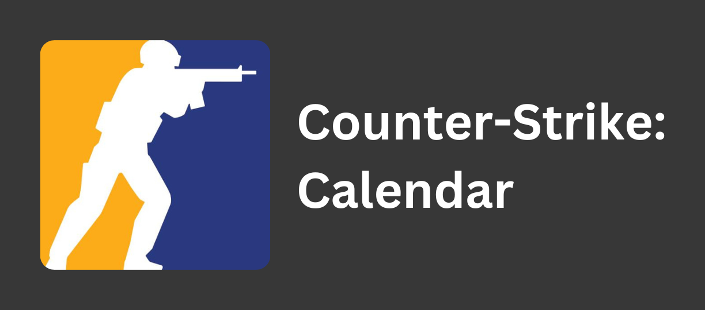

<div align="center">

<p>A UTC calendar of professional Counter-Strike matches</p>

<a href="https://github.com/silasmcnutt/counter-strike-calendar/blob/main/LICENSE.txt"></a>
</div>

# Counter-Strike Calendar

Follow professional Counter-Strike matches through calendar subscriptions.

## Choose a calendar

### All teams

Subscribe to every qualifying match:

```text
https://raw.githubusercontent.com/silasmcnutt/counter-strike-calendar/main/ics/!-ALL-TEAMS-!.ics
```

### Individual teams

Each team has its own calendar. Team filenames are lowercase and hyphenated.
Replace `<team-name>` with the team's filename:

```text
https://raw.githubusercontent.com/silasmcnutt/counter-strike-calendar/main/ics/<team-name>.ics
```

Examples:

```text
https://raw.githubusercontent.com/silasmcnutt/counter-strike-calendar/main/ics/spirit.ics
https://raw.githubusercontent.com/silasmcnutt/counter-strike-calendar/main/ics/natus-vincere.ics
https://raw.githubusercontent.com/silasmcnutt/counter-strike-calendar/main/ics/g2.ics
```

Team calendars contain every upcoming and recent match involving that team,
regardless of event prestige or prize pool. They include score updates and map
scores when available. Matches are kept for two weeks, just like the all-teams
calendar.

## Add a calendar

**Option 1: Native subscription (simplest)**
Use the subscription URL in Google Calendar, Apple Calendar, Outlook, or
another calendar app.

For Google Calendar:

1. Open **Other calendars**.
2. Select **From URL**.
3. Paste the calendar URL.
4. Select **Add calendar**.

Calendar apps control how often they refresh subscriptions (typically every
few hours). This project updates the feeds approximately every four hours.

**Option 2: Automated sync via Google Apps Script (more frequent)**
If you need updates more often than the native subscription provides,
use the included Google Apps Script to synchronize the ICS feed to a
calendar you own every 15 minutes.

## Automated Google Calendar Sync (Google Apps Script)

For more reliable, frequent updates than native calendar subscriptions, use the included Google Apps Script to automatically synchronize an ICS feed to your Google Calendar every 15 minutes.

### Setup

1. **Create a new Google Apps Script project**
   - Go to [script.google.com](https://script.google.com)
   - Click **New Project**
   - Name it (e.g., "Counter-Strike Calendar Sync")

2. **Copy the script**
   - Copy the entire contents of [`gas-ics-sync.gs`](./gas-ics-sync.gs) into the editor
   - Replace the default `Code.gs` content

3. **Configure the script**
   - Edit the **CONFIGURATION** section at the top:
     ```javascript
     const CONFIG = {
       icsUrl: 'https://raw.githubusercontent.com/silasmcnutt/counter-strike-calendar/main/ics/!-ALL-TEAMS-!.ics',
       calendarId: 'your-calendar-id@group.calendar.google.com',
       syncInterval: 15,
     };
     ```
   - **Finding your Calendar ID:**
     1. Open Google Calendar → Settings (gear icon) → Settings
     2. **Create a new calendar** (left sidebar → **+ Create calendar** → name it → **Create calendar**)
     3. Select that new calendar on the left
     4. Scroll to **Integrate calendar** → copy **Calendar ID**
     - **Must be a calendar you own**, not a subscribed/imported calendar (those are read-only and end with `@import.calendar.google.com`)

4. **Authorize the script**
   - Click **Run** → `install`
   - Approve the authorization popup (choose your account, allow access)

5. **Run initial sync**
   - Click **Run** → `startSync`
   - Check **Executions** log for results (events deleted/imported)

6. **Verify automatic trigger**
   - The `install()` function creates a 15-minute time-driven trigger
   - Check **Triggers** (clock icon) → confirm `startSync` runs every 15 minutes

### Stopping Synchronization

To stop automatic sync:
- In the Apps Script editor, click **Triggers** (clock icon) → delete the `startSync` trigger
- Or run `uninstall()` from the editor

### How It Works

This script is a lightweight, standalone replacement for **[GAS-ICS-Sync](https://github.com/motemen/gas-ics-sync)**. Unlike native calendar subscriptions (which Google controls and may refresh slowly), this script:

- Runs on Google's servers every 15 minutes via time-driven trigger
- **Completely replaces** the target calendar's events with the latest ICS feed
- Downloads → validates → deletes all old events → imports all new events (atomic-ish)
- Uses a script lock to prevent overlapping runs
- Logs detailed results (events deleted, events imported, errors)

### Limitations

- **Destructive:** Every sync deletes ALL events in the target calendar — use a dedicated calendar
- **Partial failure:** If import fails mid-way, calendar may contain partial events (no transactional rollback)
- **Execution time:** Large calendars (>500 events) may exceed 6-minute max execution time
- **No incremental sync:** By design — the ICS source is the source of truth

## Match selection

The feeds focus on larger events with:

- A prestige score of at least **80**
- A prize pool of at least **$100,000**

Upcoming and recent matches are included. Completed matches remain available
for two weeks.

## License

This project is available under the [MIT License](./LICENSE.txt).
